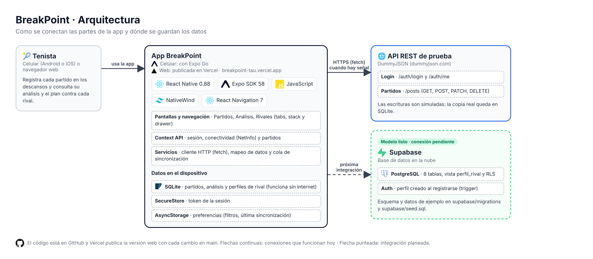
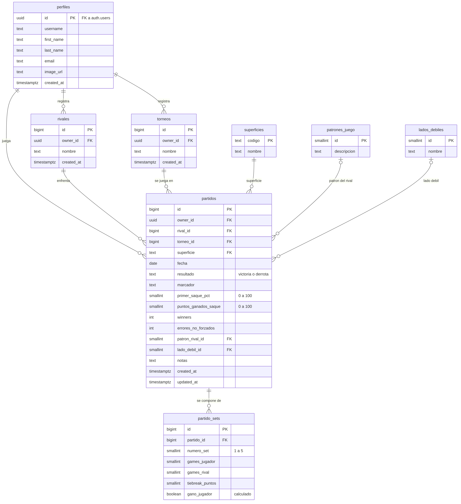

# 🎾 BreakPoint
 
Aplicación móvil para que los tenistas registren sus partidos, hagan seguimiento a sus resultados, fortalezas y oportunidades, y las de sus rivales, y reciban un plan para los siguientes encuentros.
 
🔗 **Pruébala en línea:** [breakpoint-tau.vercel.app](https://breakpoint-tau.vercel.app/) (versión web; el usuario y la contraseña de prueba ya vienen precargados).
 
📱 **En el celular:** se ejecuta con Expo Go (ver [Cómo ejecutarla en local](#-cómo-ejecutarla-en-local)).
 
Proyecto personal, desarrollado por iniciativa propia.
 
---
 
## 🧩 El problema
 
Los tenistas, sobre todo los amateur, no tienen una herramienta sencilla para hacer seguimiento a sus partidos:
 
1. **Sin seguimiento de resultados:** no tienen equipo técnico, video ni estadísticas. Salen de la cancha sin datos claros de qué hicieron bien y qué deben mejorar.
2. **Sin información del rival:** es difícil identificar las fortalezas y debilidades del rival, así que llegan a cada partido sin un plan.
3. **Poca señal en las canchas:** las herramientas que dependen de internet fallan justo donde se necesitan.
 
## 🎯 El objetivo
 
Desarrollar una aplicación móvil que permita a los tenistas registrar de forma rápida, durante los descansos, el desempeño de cada partido; hacer seguimiento a sus resultados, fortalezas y oportunidades, y a las de sus rivales; y obtener un plan estratégico para los encuentros posteriores, incluso sin conexión a internet.
 
## 💡 La solución
 
**BreakPoint** es una app móvil (Android, iOS y web) que convierte los descansos del partido en datos:
 
- **Registro rápido en la cancha:** marcador por sets, porcentaje de primer saque, puntos ganados con el saque, winners, errores no forzados, el patrón que repite el rival y su lado débil, además de torneo, superficie, fecha y notas.
- **Análisis propio:** rendimiento por superficie, sets y tiebreaks ganados, remontadas, balance de winners contra errores no forzados y los patrones más frecuentes de los rivales.
- **Perfil y plan por rival:** historial de cruces, sets y tiebreaks contra cada rival, y un **plan para el próximo partido** con su lado débil y el patrón que suele repetir.
- **Funciona sin conexión:** todo se guarda en el celular y se sincroniza cuando vuelve la señal.
- **Adaptable:** modo claro y oscuro, dos columnas en tablet o con el celular girado, y etiquetas de accesibilidad.
 
## 🛠️ Tecnologías
 
| Capa | Tecnologías |
|---|---|
| App | React Native 0.88, Expo SDK 58, JavaScript, NativeWind (Tailwind CSS), React Navigation 7 (stack, tabs y drawer) |
| Estado y datos en el dispositivo | Context API + `useReducer`, SQLite (`expo-sqlite`), SecureStore, AsyncStorage, NetInfo |
| API | DummyJSON (API REST de prueba) con `fetch` |
| Base de datos en la nube | Supabase (PostgreSQL): modelo relacional y datos de ejemplo, listos para conectar |
| Despliegue | Vercel (versión web), GitHub |
 
## 🏗️ Arquitectura
 

 
- La **app** (React Native con Expo) es local primero: lee y escribe en **SQLite**, así que la lista de partidos, el análisis y los perfiles de rival funcionan sin internet.
- Cuando hay señal, se sincroniza con la **API REST de prueba** (DummyJSON) usando `fetch`. El inicio de sesión usa la misma API y el token se guarda en **SecureStore**.
- La **versión web** está publicada en **Vercel**, que la vuelve a publicar sola con cada cambio en la rama `main` de GitHub.
- **Supabase** tiene listo el modelo relacional en PostgreSQL, con datos de ejemplo. La app todavía no se conecta a él: es la siguiente integración.
 
## 🗃️ Modelo relacional
 

 
La base de datos en Supabase tiene **8 tablas**:
 
- **Partidos:** `partidos` y `partido_sets` (el marcador desglosado set por set, con tiebreaks).
- **Datos de cada jugador:** `perfiles` (vinculada a Supabase Auth), `rivales` y `torneos`.
- **Catálogos:** `superficies`, `patrones_juego` y `lados_debiles`.
 
La vista `perfil_rival` calcula el perfil de cada rival: victorias, derrotas, promedio de errores, su lado débil y patrón más frecuentes, y los sets y tiebreaks jugados. Todas las tablas tienen **políticas RLS**: cada jugador solo ve y modifica sus propios datos. Las migraciones están en `supabase/migrations` y los datos de ejemplo en `supabase/seed.sql`.
 
## 📴 Funcionamiento sin conexión
 
- **Local primero:** al abrir una pantalla se muestran los datos de SQLite; si hay conexión, se consultan los del servidor y se actualiza la copia local.
- **Cambios pendientes:** crear, editar o eliminar sin internet deja la operación como **Pendiente**. Al volver la conexión se sincroniza sola y pasa a **Sincronizado** (o **Falló**, con opción de reintentar).
- **Conflictos:** gana el servidor, salvo que el partido tenga cambios locales sin sincronizar. Así nunca se pierde lo que el jugador anotó en la cancha.
 
## 👤 Mi rol en el proyecto
 
**Emmanuel Sánchez Ossa** · Desarrollador. Proyecto individual, por iniciativa propia.
 
- **Idea:** identifiqué que los tenistas no tenían una forma sencilla de hacer seguimiento a sus partidos y a sus rivales.
- **App:** diseño y desarrollo de las pantallas, la navegación, el análisis y el plan por rival.
- **Datos sin conexión:** base de datos local en SQLite, sincronización y estrategia de conflictos.
- **Base de datos en la nube:** modelo relacional en Supabase con migraciones, vista de perfil por rival, políticas RLS y datos de ejemplo.
 
[LinkedIn](https://www.linkedin.com/in/emmanuel-sanchez-ossa) · [GitHub](https://github.com/Nuelso-dev)
 
## 📁 Estructura del repositorio
 
```
breakpoint/
├── App.js                 # Proveedores globales y tema
├── index.js               # Punto de entrada
├── app.json               # Configuración de Expo
├── vercel.json            # Publicación de la versión web en Vercel
├── src/
│   ├── components/        # Componentes reutilizables (tarjetas, botones, marcador por sets…)
│   ├── constants/         # Configuración, catálogos de tenis y tema
│   ├── context/           # Sesión, conectividad y partidos
│   ├── database/          # Conexión a SQLite y todo el SQL local
│   ├── hooks/             # Tema claro/oscuro
│   ├── navigation/        # Stack, tabs y drawer
│   ├── screens/           # Partidos, Análisis, Rivales, login y configuración
│   ├── services/          # Cliente HTTP, API, sesión y sincronización
│   └── utils/             # Sets, validaciones, formatos y errores
├── supabase/
│   ├── migrations/        # Modelo relacional para Supabase
│   ├── seed.sql           # Datos de ejemplo
│   └── README.md          # Detalle del modelo
└── docs/                  # Diagramas del README
```
 
## 💻 Cómo ejecutarla en local
 
**Requisitos:** Node.js 20 o superior y la app **Expo Go** en el celular (Android o iOS).
 
**1. Clonar e instalar**
 
```bash
git clone https://github.com/Nuelso-dev/breakpoint.git
cd breakpoint
npm install
```
 
Si tu versión de Expo no coincide con la del `package.json`, alinea las dependencias con `npx expo install --fix`.
 
**2. Arrancar el proyecto**
 
```bash
npx expo start -c
```
 
- **En el celular:** escanea el código QR con Expo Go. El celular y el computador deben estar en la misma red Wi-Fi.
- **En el navegador:** presiona `w` en la terminal (o ejecuta `npm run web`).
 
La bandera `-c` limpia la caché; es necesaria la primera vez por la configuración de NativeWind.
 
**3. Iniciar sesión**
 
| Campo | Valor |
|---|---|
| Usuario | `emilys` |
| Contraseña | `emilyspass` |
 
Vienen precargadas en la pantalla de inicio de sesión (son las credenciales de prueba de DummyJSON).
 
**Para probar el modo sin conexión:** activa el modo avión, registra o edita un partido y verás el estado **Pendiente**. Al desactivarlo, se sincroniza solo.
 
## 🚀 Despliegue
 
**Versión web (Vercel):** publicada en [breakpoint-tau.vercel.app](https://breakpoint-tau.vercel.app/). El archivo `vercel.json` le indica a Vercel cómo construirla (`npx expo export -p web`), qué carpeta publicar (`dist`) y los encabezados de seguridad que necesita SQLite para funcionar en el navegador. Cada cambio que llega a la rama `main` se publica automáticamente.
 
**App móvil:** se ejecuta con Expo Go (ver [Cómo ejecutarla en local](#-cómo-ejecutarla-en-local)).
 
**Base de datos en Supabase:** aplica las migraciones de `supabase/migrations` (por ejemplo con `supabase db push`) y luego ejecuta `supabase/seed.sql` en el SQL Editor. El detalle está en [supabase/README.md](supabase/README.md).
 
