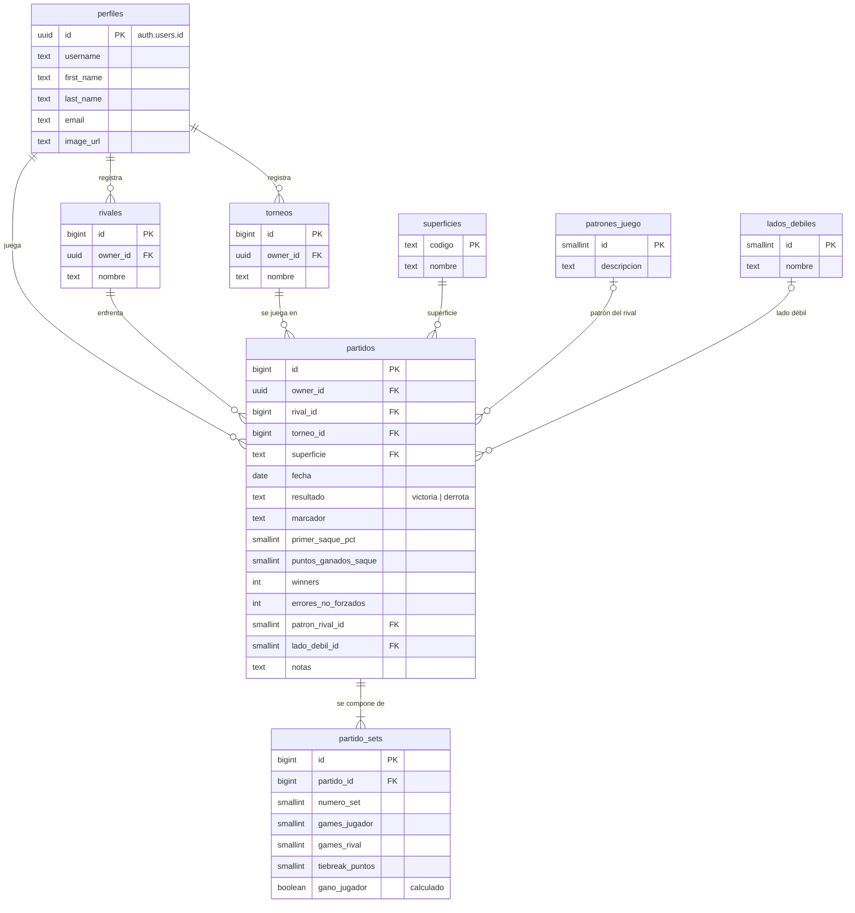

# Modelo relacional en Supabase

La app guarda los partidos en SQLite (una sola tabla `matches`, ver `src/database/db.js`).
Este es el mismo dominio normalizado para Postgres/Supabase. Las migraciones de esta
carpeta crean el esquema completo y se pueden aplicar con `supabase db push`.

## Tablas

| Tabla | Origen en el código |
|---|---|
| `perfiles` | Usuario de la sesión (`authService.js`) |
| `rivales`, `torneos` | Columnas `rival` y `torneo` de `matches` |
| `partidos` | Tabla `matches` |
| `partido_sets` | Columna `marcador` desglosada set por set (`src/utils/sets.js`) |
| `superficies`, `patrones_juego`, `lados_debiles` | Catálogos de `src/constants/tennis.js` |

La vista `perfil_rival` equivale a `getRivalProfiles` del repositorio local e incluye
sets ganados, perdidos y tiebreaks por rival.

Los campos de sincronización (`sync_status`, `pending_action`, `remote_id`, etc.) solo
existen en la copia local del dispositivo, por eso no están en el servidor.

Todas las tablas tienen RLS: cada jugador solo ve y modifica sus propios datos.

## Datos de ejemplo (`seed.sql`)

`seed.sql` carga los mismos datos que la app muestra con la API de prueba:

- 1 perfil: el usuario demo `emilys` de `LoginScreen.js` (sin contraseña: solo es dueño de los datos).
- 12 rivales y 10 torneos: las listas `RIVALES` y `TORNEOS` de `matchMapper.js`.
- 24 partidos: los que `matchMapper.js` deriva de los posts 1 a 24 de DummyJSON (`REMOTE_PAGE_LIMIT`).
- 58 sets: el marcador de cada partido desglosado con `src/utils/sets.js`.

Se puede ejecutar varias veces sin duplicar registros.
